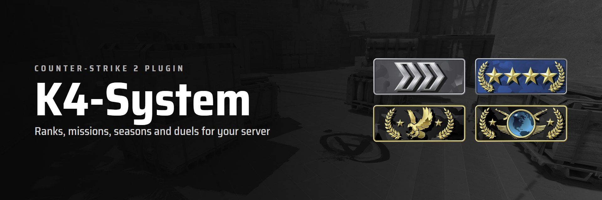
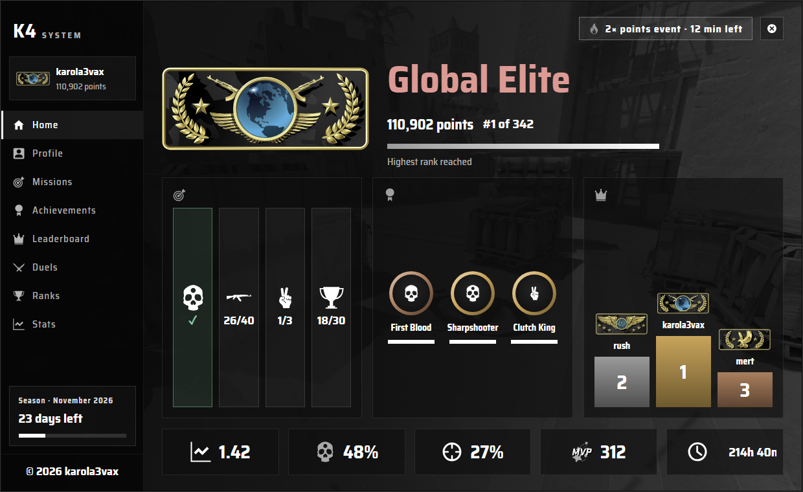
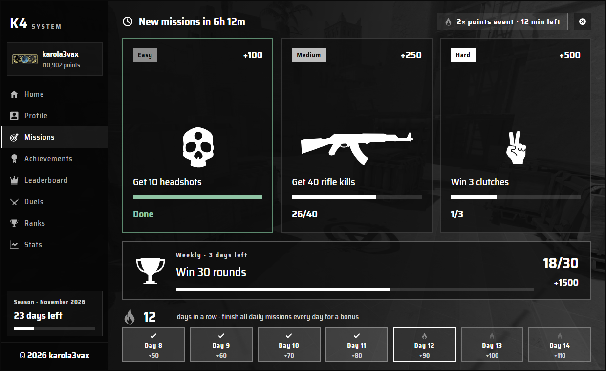
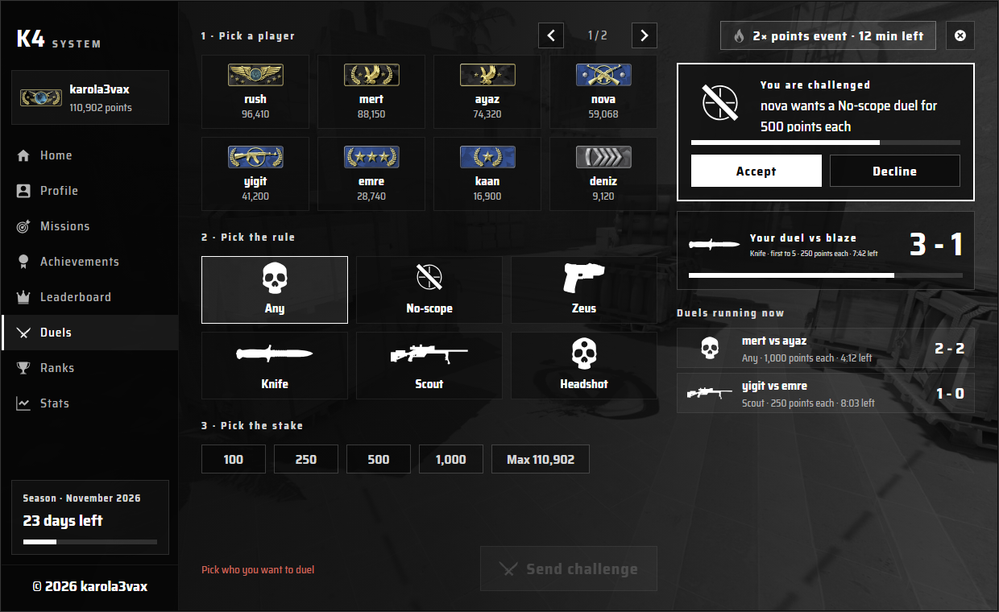
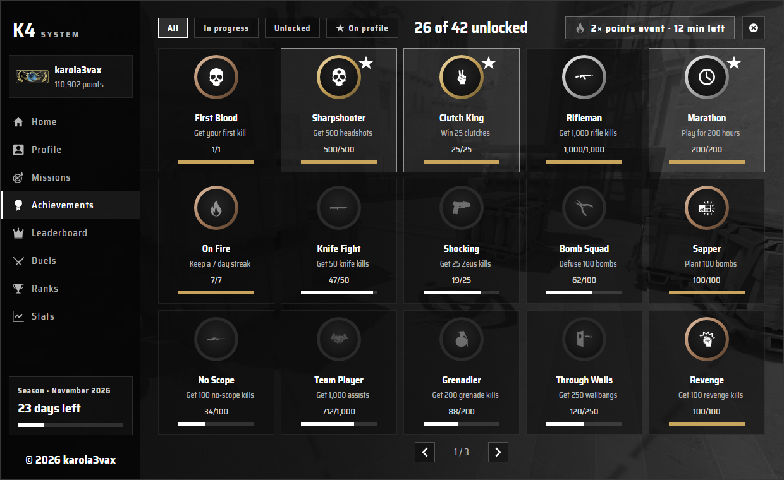
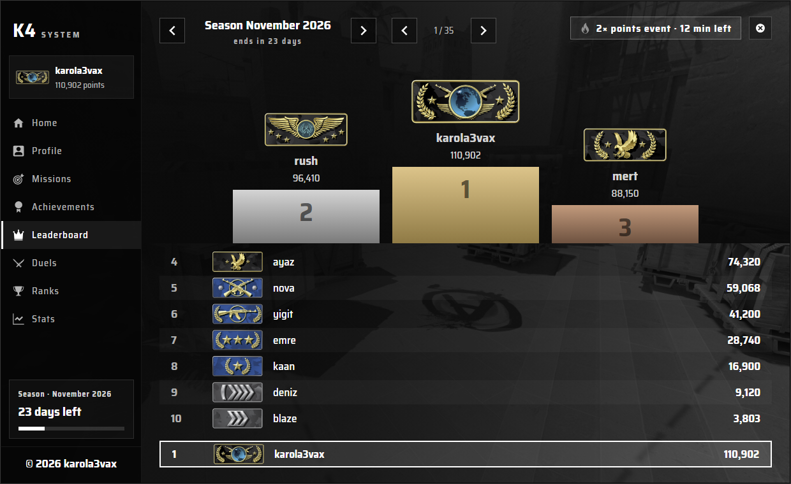

  

  
  

  <a href="https://github.com/karola3vax/K4-System/releases/latest"><strong>Download</strong></a>
  &nbsp;&bull;&nbsp;
  <a href="#install"><strong>Install</strong></a>
  &nbsp;&bull;&nbsp;
  <a href="#documentation"><strong>Documentation</strong></a>
  &nbsp;&bull;&nbsp;
  <a href="https://discord.com/invite/gaAUsKAuqQ"><strong>Discord</strong></a>

K4-System adds a rank ladder to your Counter-Strike 2 server. Players earn points for kills, objectives and round wins, see their rank on the scoreboard, and get new missions every day. It runs on [CounterStrikeSharp](https://github.com/roflmuffin/CounterStrikeSharp) and uses SQLite with no setup, or MySQL for several servers.

  

The optional in-game panel. Images on this page are browser previews with sample data, not in-game captures.

## What players get

- **Ranks.** The default ladder follows CS2's matchmaking ranks, and the rank shows as a CS2 icon on the scoreboard.
- **Missions.** Three daily missions and one weekly mission that fit the current map, with a bonus for a streak of days.
- **Achievements.** 21 long-term goals with one-time rewards.
- **Seasons.** Points start over on the 1st of each month. Final results are kept.
- **Duels.** A kill race for points with a rule: any kill, no-scope, Zeus, knife, Scout or headshot.
- **Bounties and points events.** A long kill streak puts a bounty on a player, and points events can be scheduled, such as double points on weekend evenings, or started by an admin.
- **A clickable panel** for all of this, plus profiles, stats and the leaderboard. It's optional and uses a free Workshop addon.
- **Their language.** 36 languages, and each player can pick their own.

## What server owners get

- **A quick start.** Install it, start the server, and it runs on SQLite. Switch to MySQL for several servers or a web panel.
- **One commented config file** for point values and presets, the rank ladder, missions, messages and command names.
- **Rank rewards**, such as a VIP flag or a chat tag, given once when a player reaches a rank.
- **Fair counting.** Warmup, bots, team kills, AFK players and a minimum player count are handled, and anti-farming stops points being fed from a second account or a friend.
- **Admin tools.** `css_k4_history` shows every manual point change, and `css_k4_reload` applies config changes without a restart.
- **Other server setups.** Rank-only or permission-only ladders, free-for-all servers, LVL Ranks-style `!lvl` and public `!rank` lines, and a LevelRanks table for older web panels.

## The panel

<table>
  <tr>
    <td width="50%" valign="top"> <strong>Missions:</strong> daily and weekly missions, and the streak</td>
    <td width="50%" valign="top"> <strong>Duels:</strong> pick a player, a rule and a stake</td>
  </tr>
  <tr>
    <td valign="top"> <strong>Achievements:</strong> medals, progress and what's on your profile</td>
    <td valign="top"> <strong>Leaderboard:</strong> the top players, your place and past seasons</td>
  </tr>
</table>

## Install

You need a Counter-Strike 2 dedicated server with [CounterStrikeSharp](https://github.com/roflmuffin/CounterStrikeSharp) (API 1.0.376 or newer).

1. Download the [latest release](https://github.com/karola3vax/K4-System/releases/latest).
2. Extract the zip into `game/csgo/addons/counterstrikesharp/`, keeping its folders.
3. Start the server. K4-System creates its files and starts tracking on SQLite.
4. Open `addons/counterstrikesharp/configs/plugins/K4-System/k4-system.jsonc` and adjust what you like. Every setting has a comment.
5. Restart the server.

Players type `!k4` to see what they can do. For the clickable panel, add Workshop addon `3811667212` with [MultiAddonManager](https://github.com/Source2ZE/MultiAddonManager), as described in the [panel guide](panorama/README.md#turn-it-on-for-a-server).

## Documentation

| Page | What it covers |
| --- | --- |
| [Installation and updates](docs/installation.md) | Requirements, files, updating to a new version, upgrading from 5.x |
| [Configuration](docs/configuration.md) | Every setting, SQLite or MySQL, point presets, rank modes, permission ranks, rank rewards, scoreboard ranks, languages and tags |
| [Commands and permissions](docs/commands.md) | Player commands, admin commands, permissions |
| [Missions](docs/missions.md) | How missions work, every mission type, map rules, the weekly mission |
| [Achievements](docs/achievements.md) | Long-term goals with one-time rewards, the achievement list, your own achievements |
| [Seasons](docs/seasons.md) | Monthly point resets, past season results, ending a season early, undoing a reset |
| [Profiles](docs/profiles.md) | Player profiles, favorite weapon, choosing achievements to show |
| [Panel guide](panorama/README.md) | Setting up the clickable in-game panel and the Workshop addon |
| [Common problems](docs/troubleshooting.md) | What to check when something does not work |
| [For developers](docs/developers.md) | How it works, the shared API, building from source |
| [Changelog](CHANGELOG) | Every change, version by version |

## Help

- **Questions and support:** the [Discord server](https://discord.com/invite/gaAUsKAuqQ).
- **Bugs and ideas:** [open an issue](https://github.com/karola3vax/K4-System/issues/new/choose). The form asks for the details that help.

K4-System is free. If it helps your server, you can support its development on [Buy Me a Coffee](https://buymeacoffee.com/karola3vax).

## Credits and license

K4-System was created by [K4ryuu](https://github.com/K4ryuu) and KitsuneLab, with help from [KillStr3aK](https://github.com/KillStr3aK) and [the original contributors](https://github.com/KitsuneLab-Development/K4-System/graphs/contributors). It is rewritten and maintained by [karola3vax](https://github.com/karola3vax). The original author's newer project is [K4-Zenith](https://github.com/K4ryuu/K4-Zenith).

Distributed under the [GPL-3.0 license](LICENSE.md).

The Workshop addon and the images on this page use CS2's own rank emblems and icons. Counter-Strike and its assets belong to Valve and are not covered by the GPL.
