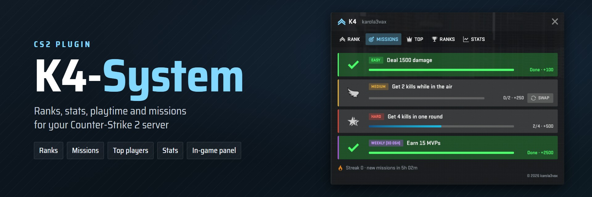
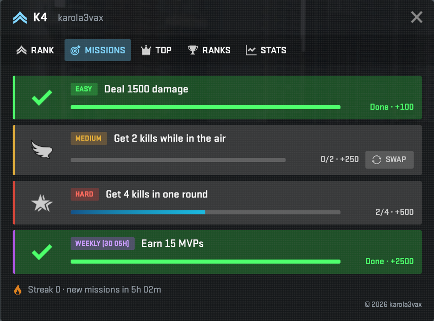
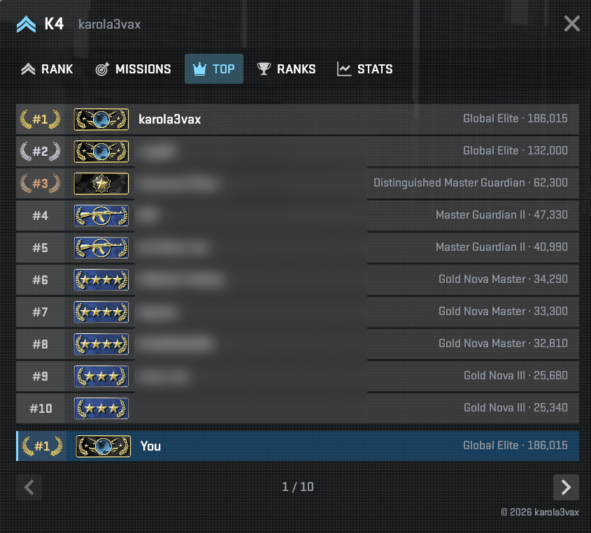
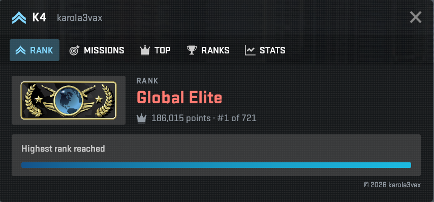
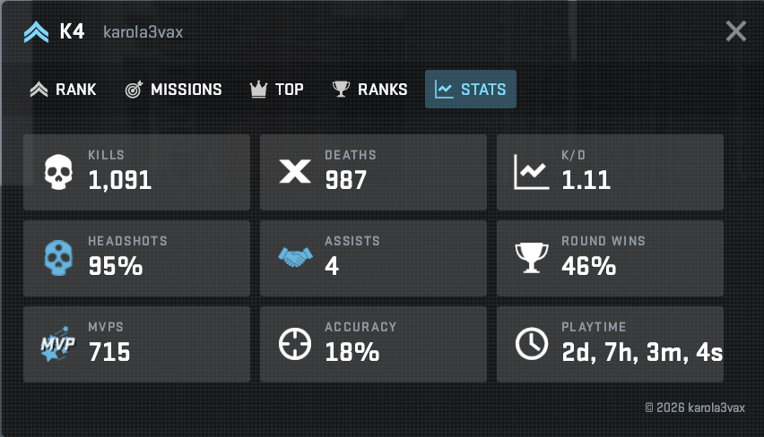
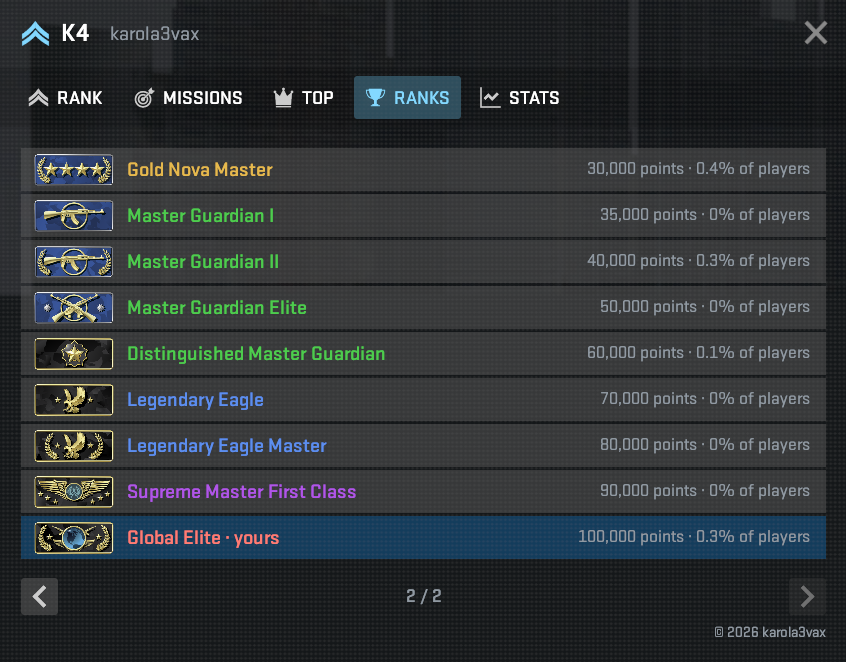

  

  
  

  <a href="https://github.com/karola3vax/K4-System/releases/latest"><strong>Download</strong></a>
  &nbsp;&bull;&nbsp;
  <a href="#install"><strong>Install</strong></a>
  &nbsp;&bull;&nbsp;
  <a href="#documentation"><strong>Documentation</strong></a>
  &nbsp;&bull;&nbsp;
  <a href="https://discord.com/invite/gaAUsKAuqQ"><strong>Discord</strong></a>

K4-System gives your Counter-Strike 2 server a rank ladder that players climb with points. Kills, objectives and round wins earn points, players see their rank on the scoreboard, and daily and weekly missions give them something new to play for every day. It runs on [CounterStrikeSharp](https://github.com/roflmuffin/CounterStrikeSharp) and works with SQLite out of the box or MySQL for several servers.

<table align="center">
  <tr>
    <td align="center"></td>
    <td align="center"></td>
    <td align="center"></td>
    <td align="center"></td>
    <td align="center"></td>
    <td align="center"></td>
    <td align="center"></td>
  </tr>
</table>

The default ladder follows CS2's matchmaking ranks. Every rank, point threshold, tag and reward can be changed.

## What players get

- **A rank that grows with them.** Points for kills, headshots, objectives and round wins, shown as a CS2 rank icon on the scoreboard.
- **Missions every day.** Three daily missions and one weekly mission that fit the current map, with a streak bonus for playing several days in a row.
- **Bounties and duels.** A long kill streak makes a player WANTED, with bonus points for whoever ends it. Players can bet points on who gets more kills this map with `!duel`. Both are rare, so they stay special.
- **A clickable panel** in CS2's own style for their rank, missions, the top players, all ranks and their stats (optional, through a free Workshop addon).
- **Their own stats and playtime**, and the server's top list.
- **Their language.** K4-System speaks 36 languages, and each player can pick their own.

## What server owners get

- **Works right away.** Drop it in, start the server, and it runs on SQLite. Switch to MySQL when you run several servers or a web panel.
- **Everything is adjustable** in one commented config file: point values (with ready presets for casual, competitive and deathmatch), the rank ladder, missions, messages and command names.
- **Rewards for ranks**, such as a VIP flag or a chat tag, given once when a player reaches a rank.
- **Fair counting.** Warmup, bots, team kills, AFK players and a minimum player count are handled for you.
- **Fits your server.** Rank-only or permission-only ladders, free-for-all servers, LVL Ranks-style `!lvl` and public `!rank` lines, and a LevelRanks table for older web panels.

## Screenshots

<table>
  <tr>
    <td width="50%" valign="top"> <strong>Missions:</strong> three daily missions and one weekly mission that fit the map</td>
    <td width="50%" valign="top"> <strong>Top:</strong> the server's best players, and your own place</td>
  </tr>
  <tr>
    <td valign="top"> <strong>Rank:</strong> your rank, points, place and progress to the next rank</td>
    <td valign="top"> <strong>Stats:</strong> kills, K/D, headshots, MVPs, accuracy and playtime</td>
  </tr>
  <tr>
    <td colspan="2" align="center"> <strong>Ranks:</strong> every rank, the points it needs, and how many players have it</td>
  </tr>
</table>

## Install

You need a Counter-Strike 2 dedicated server with [CounterStrikeSharp](https://github.com/roflmuffin/CounterStrikeSharp) (API 1.0.376 or newer).

1. Download the [latest release](https://github.com/karola3vax/K4-System/releases/latest).
2. Extract the zip into `game/csgo/addons/counterstrikesharp/`, keeping its folders.
3. Start the server. K4-System creates its files and starts tracking on SQLite.
4. Open `addons/counterstrikesharp/configs/plugins/K4-System/k4-system.jsonc` and adjust what you like. Every setting has a comment.
5. Restart the server.

Players type `!k4` to see everything they can do. For the clickable panel, add the Workshop addon as described in the [panel guide](panorama/README.md).

## Documentation

| Page | What it covers |
| --- | --- |
| [Installation and updates](docs/installation.md) | Requirements, files, updating to a new version, upgrading from 5.x |
| [Configuration](docs/configuration.md) | Every setting, SQLite or MySQL, point presets, rank modes, permission ranks, rank rewards, scoreboard ranks, languages and tags |
| [Commands and permissions](docs/commands.md) | Player commands, admin commands, permissions |
| [Missions](docs/missions.md) | How missions work, every mission type, map rules, the weekly mission |
| [Panel guide](panorama/README.md) | Setting up the clickable in-game panel and the Workshop addon |
| [Common problems](docs/troubleshooting.md) | What to check when something does not work |
| [For developers](docs/developers.md) | How it works, the shared API, building from source |
| [Changelog](CHANGELOG) | Every change, version by version |

## Help

- **Questions and support:** the [Discord server](https://discord.com/invite/gaAUsKAuqQ).
- **Bugs and ideas:** [open an issue](https://github.com/karola3vax/K4-System/issues/new/choose). The form asks for the details that help.

K4-System is free. If it helps your server, you can support its development on [Buy Me a Coffee](https://buymeacoffee.com/karola3vax).

## Credits and license

K4-System was created by [K4ryuu](https://github.com/K4ryuu) and KitsuneLab, with help from [KillStr3aK](https://github.com/KillStr3aK) and [the original contributors](https://github.com/KitsuneLab-Development/K4-System/graphs/contributors). It is rewritten and maintained by [karola3vax](https://github.com/karola3vax). The original author's newer project is [K4-Zenith](https://github.com/K4ryuu/K4-Zenith).

Distributed under the [GPL-3.0 license](LICENSE.md).

The rank icons on this page come from [ItzArty/csgo-rank-icons](https://github.com/ItzArty/csgo-rank-icons/tree/29cde4ddd2758458f1c67653ad32e0198b5484f9). The Workshop addon carries sharp copies of CS2's own rank emblems. Counter-Strike and its assets, including these emblems, belong to Valve and are not covered by the GPL.
