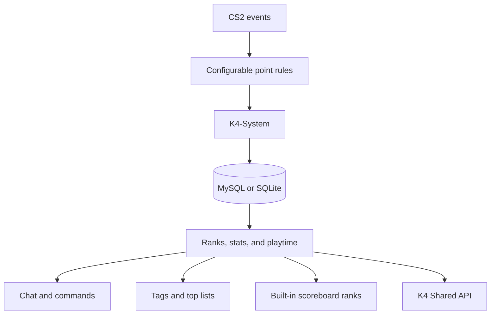

<a id="readme-top"></a>

<div align="center">
  <h1>K4-System</h1>

  <p><strong>Ranks, points, stats, playtime, rewards, and scoreboard integrations for Counter-Strike 2.</strong></p>
  <p>A maintained CounterStrikeSharp fork built for modern community servers.</p>

  <p>
    <a href="https://github.com/karola3vax/K4-System/releases"></a>
    <a href="LICENSE.md"></a>
  </p>

  <p>
    <a href="https://github.com/karola3vax/K4-System/releases"><strong>Download</strong></a>
    &nbsp;&bull;&nbsp;
    <a href="#quick-install"><strong>Install</strong></a>
    &nbsp;&bull;&nbsp;
    <a href="#commands"><strong>Commands</strong></a>
    &nbsp;&bull;&nbsp;
    <a href="#scoreboard-ranks"><strong>Scoreboard ranks</strong></a>
  </p>
</div>

<table align="center">
  <tr>
    <td align="center"><br><sub>Silver I</sub></td>
    <td align="center"><br><sub>Silver IV</sub></td>
    <td align="center"><br><sub>Gold Nova I</sub></td>
    <td align="center"><br><sub>Gold Nova Master</sub></td>
    <td align="center"><br><sub>Master Guardian Elite</sub></td>
    <td align="center"><br><sub>Legendary Eagle Master</sub></td>
    <td align="center"><br><sub>Global Elite</sub></td>
  </tr>
</table>

<p align="center"><sub>Milestones from the default rank ladder. Every rank, threshold, tag, color, permission gate, and reward is configurable.</sub></p>

<table align="center">
  <tr>
    <td align="center">
      <a href="#scoreboard-ranks">
        
      </a>
      <br><strong>Premier points</strong>
      <br><sub>Show each player's live K4-System point total as a Premier-style scoreboard rating.</sub>
    </td>
  </tr>
</table>

<p align="center">
  <a href="#features">Features</a>
  &nbsp;&bull;&nbsp;
  <a href="#how-it-works">How it works</a>
  &nbsp;&bull;&nbsp;
  <a href="#configuration">Configuration</a>
  &nbsp;&bull;&nbsp;
  <a href="#rank-game-modes">Game modes</a>
  &nbsp;&bull;&nbsp;
  <a href="#scoreboard-ranks">Scoreboard ranks</a>
  &nbsp;&bull;&nbsp;
  <a href="#common-problems">Troubleshooting</a>
</p>

> [!IMPORTANT]
> **K4-System is one complete plugin.** Scoreboard ranks and rank visibility are built in. K4-System-MMRanks and FakeRanks RevealAll are not required.

---

## Features

<table>
  <tr>
    <td width="33%" valign="top"><strong>🏅 Configurable progression</strong><br><br>Build any rank ladder, tune every point event, and show promotions, demotions, and top-list placement.</td>
    <td width="33%" valign="top"><strong>📊 Persistent player history</strong><br><br>Store ranks, detailed statistics, and playtime in MySQL or SQLite across reconnects and map changes.</td>
    <td width="33%" valign="top"><strong>🚩 Three rank modes</strong><br><br>Run regular progression, permission-gated ranks only, or a ladder with no flagged ranks.</td>
  </tr>
  <tr>
    <td width="33%" valign="top"><strong>🎁 One-time rank rewards</strong><br><br>Run configured server commands once when a player reaches a rank, with multiline colored descriptions.</td>
    <td width="33%" valign="top"><strong>🏷️ Visible server identity</strong><br><br>Display rank tags, admin tags, country tags, and optional matchmaking-style scoreboard icons.</td>
    <td width="33%" valign="top"><strong>🌍 Community ready</strong><br><br>Use 36 languages, per-player language choice, configurable aliases, bot and FFA rules, shared API access, and LevelRanks compatibility.</td>
  </tr>
</table>

### Players get

- A permanent rank and point total
- Personal stats and playtime commands
- Promotion, demotion, reward, and point messages
- Rank lists and server top lists
- Three daily missions and one weekly mission that fit the map, with a growing streak bonus
- Scoreboard tags and optional matchmaking rank icons

### Server owners get

- Install-ready release packages with required dependencies
- Configurable modules, commands, point values, ranks, and messages
- Permission-aware progression and admin targeting
- MySQL or built-in SQLite storage, optional LevelRanks tables, and a shared player API
- CounterStrikeSharp.API `1.0.376`, .NET 10, hot-reload, and map-change fixes

## How it works



Gameplay events update the enabled modules. K4-System caches active players, saves their progress to MySQL or SQLite in the background, and exposes the result through chat, commands, tags, top lists, built-in scoreboard ranks, and the shared API.

## Quick install

### Requirements

| Component | Requirement |
| --- | --- |
| Game server | Counter-Strike 2 dedicated server |
| Plugin framework | [CounterStrikeSharp](https://github.com/roflmuffin/CounterStrikeSharp), built against and requiring API `1.0.376` or newer |
| Runtime | .NET `10` |
| Storage | MySQL-compatible database, or the built-in SQLite option |
| Optional GeoIP | `GeoLite2-Country.mmdb` for country tags |

### Install in six steps

1. Download the [current K4-System package](https://github.com/karola3vax/K4-System/releases).
2. Extract the ZIP into `game/csgo/addons/counterstrikesharp/` and keep its folder structure intact.
3. Start the server once. K4 creates `k4-system.jsonc` and `ranks.jsonc` and runs on SQLite right away.
4. To use MySQL instead, set `storage.type` to `mysql` and fill in `storage.mysql`.
5. Pick a point preset and review modules, tags, scoreboard display, commands, and the rank ladder.
6. Restart K4-System and confirm that it loads without errors.

| File | Location |
| --- | --- |
| Main configuration | `addons/counterstrikesharp/configs/plugins/K4-System/k4-system.jsonc` |
| Rank ladder | `addons/counterstrikesharp/plugins/K4-System/ranks.jsonc` |
| Mission list | `addons/counterstrikesharp/plugins/K4-System/missions.jsonc` |
| Language files (replaced by updates) | `addons/counterstrikesharp/plugins/K4-System/lang/` |
| Your own wording (kept by updates) | `addons/counterstrikesharp/configs/plugins/K4-System/lang/` |
| Optional GeoIP database | Beside `K4-System.dll` |

<details>
<summary><strong>Expected release package layout</strong></summary>

```text
addons/counterstrikesharp/
├── plugins/
│   └── K4-System/
│       ├── K4-System.dll
│       ├── Dapper.dll
│       ├── MaxMind.Db.dll
│       ├── MaxMind.GeoIP2.dll
│       ├── K4-System.deps.json
│       ├── Microsoft.Data.Sqlite.dll
│       ├── MySqlConnector.dll
│       ├── SQLitePCLRaw.*.dll
│       ├── runtimes/
│       │   ├── linux-x64/native/libe_sqlite3.so
│       │   └── win-x64/native/e_sqlite3.dll
│       └── lang/
│           ├── en.json
│           ├── tr.json
│           └── ...
└── shared/
    └── K4-SharedApi/
        └── K4-SharedApi.dll
```

</details>

## Configuration

All settings live in one commented file, `configs/plugins/K4-System/k4-system.jsonc`. Every setting has a comment that explains it. Delete the file to get a fresh default copy. Unknown or misspelled settings stop K4 with a message that names them, so typos never fail silently.

| Section | What it controls |
| --- | --- |
| `storage` | SQLite or MySQL, table prefix, purge of inactive players, optional LevelRanks table |
| `modules` | Turn ranks, stats, playtime, and the admin list on or off |
| `tracking` | Minimum players, warmup, bots, and free-for-all. Applies to points and stats alike |
| `ranks` | Rank mode, start points, VIP multiplier, round summary, kill streaks, reset cooldown, dynamic death points, team balance, playtime reward |
| `points` | A point preset plus your own overrides |
| `scoreboard` | What the CS2 rank area shows, custom icons, points in the score column |
| `tags` | Rank tags, top-placement tag, country tag, admin tags and `!admins` colors |
| `messages` | Join hint, connect and disconnect announcements |
| `commands` | Command names and the cooldown of `!rank`, `!top`, and `!resetmydata` |

### Storage: SQLite or MySQL

```jsonc
"storage": {
  "type": "sqlite",               // or "mysql"
  "sqlite-file": "k4system.db",   // relative paths start in plugins/K4-System/
  "mysql": { "host": "localhost", "port": 3306, "database": "cs2", "username": "root", "password": "", "ssl-mode": "None" },
  "table-prefix": ""
}
```

| Choose | When |
| --- | --- |
| `sqlite` | You run one server and want no database setup. Everything is stored in one file beside the plugin |
| `mysql` | You run several servers on one database, use a web panel, or need the LevelRanks table for an external tool |

Both use the same tables, so commands, top lists, rewards, and resets behave the same. K4 does not copy data between the two. If you replace the whole plugin folder when updating, keep `k4system.db`.

### Point presets

Choose a preset, then change single values in `overrides`:

```jsonc
"points": {
  "preset": "competitive",
  "overrides": { "kill": 12, "bomb-drop": 0 }
}
```

| Event | casual | competitive | deathmatch |
| --- | ---: | ---: | ---: |
| `kill` / `death` | 20 / -15 | 10 / -10 | 5 / -3 |
| `headshot` | 5 | 3 | 2 |
| `assist` / `flash-assist` | 10 / 15 | 4 / 3 | 1 / 1 |
| `team-kill` / `team-assist` / `team-flash-assist` | -40 / -10 / -15 | -30 / -5 / -5 | -10 / 0 / 0 |
| `suicide` | -20 | -15 | -5 |
| `noscope` / `through-smoke` / `blind-kill` / `wallbang` | 60 / 40 / 60 / 5 | 10 / 5 / 5 / 2 | 3 / 2 / 2 / 1 |
| `long-distance-kill` (from `long-distance-meters`) | 60 (30 m) | 5 (40 m) | 2 (40 m) |
| `grenade-kill` / `fire-kill` / `impact-kill` | 60 / 50 / 60 | 10 / 10 / 20 | 3 / 3 / 5 |
| `knife-kill` / `taser-kill` | 60 / 60 | 15 / 15 | 5 / 5 |
| Streaks `double-kill` … `godlike` | 10, 15, 25, 30, 40, 50, 55, 65, 70, 80, 90 | 2, 4, 6, 8, 10, then 12 | 1, 2, 3, 4, 5, then 6 |
| `round-win` / `round-loss` / `mvp` | 5 / 0 / 25 | 10 / -5 / 10 | 0 / 0 / 0 |
| `bomb-plant` / `bomb-defuse` / `bomb-defuse-team` / `bomb-explode` | 30 / 40 / 10 / 25 | 10 / 15 / 5 / 5 | 0 |
| `bomb-pickup` / `bomb-drop` | 5 / -10 | 0 / 0 | 0 |
| `hostage-rescue` / `hostage-rescue-all` / `hostage-hurt` / `hostage-kill` | 30 / 25 / -10 / -40 | 10 / 10 / -5 / -20 | 0 |
| `playtime` (every `ranks.playtime-reward.every-minutes`) | 15 | 0 | 0 |

`casual` is the 5.x default economy: about 250 to 300 hours of normal play to reach Global Elite at 100,000 points. `competitive` rewards winning rounds and clean play over flashy kills. `deathmatch` counts only kills, in small steps, for servers without rounds or objectives.

Bots are never stored as persistent ranked players. Bot settings only decide whether eligible human interactions with bots count.

## Rank game modes

Set `mode` inside `ranks`:

```jsonc
"ranks": {
  "mode": "Normal"
}
```

| Mode | Active ranks | Automatic scoring |
| --- | --- | --- |
| `Normal` | Regular and permission-gated ranks | No additional game-mode restriction |
| `FlagsOnly` | Default rank plus ranks with nonblank `RequiredPermissions` | Waits until the player matches an active flag |
| `NoFlags` | Default rank plus ranks without requirements | No additional game-mode restriction |

In `FlagsOnly`, automatic gains and losses wait until the player has a matching permission, group, or command override. Saved points remain unchanged while scoring is blocked. Admin commands and Shared API point setters remain manual overrides.

Flags are rechecked after player data loads and on the next round, score attempt, spawn, team change, manual point update, or `!rank` command. The highest eligible rank wins, lower ranks are skipped, and only the final higher-rank reward runs. Load and permission-only corrections do not backfill rewards.

Changing modes does not rewrite `ranks.jsonc`, stored points, or database tables. Active ranks receive sequential runtime IDs after filtering, so built-in scoreboard icons have no gaps. Restart K4-System after changing the mode.

## Permission-gated ranks

`RequiredPermissions` checks existing CounterStrikeSharp permissions, groups, or enabled command overrides. K4-System does not create or store those requirements. The separate `Permissions` property grants K4-owned permissions while the player holds that rank.

```jsonc
"Global Elite": {
  "Name": "Global Elite",
  "Tag": "[GE]",
  "Point": 100000,
  "Color": "lightred",
  "RequiredPermissions": ["@css/global"]
}
```

If a player has enough points but lacks the requirement, K4-System keeps them at the highest lower rank they may hold. Multiple `RequiredPermissions` entries are alternatives, so any one match is enough.

Regular and gated ranks may share a threshold to create parallel progression paths. Put the unrestricted rank first and the gated variant after it:

```jsonc
"Gold": {
  "Name": "Gold",
  "Point": 5000,
  "Color": "gold"
},
"VIP Gold": {
  "Name": "VIP Gold",
  "Point": 5000,
  "Color": "lightred",
  "RequiredPermissions": ["@css/vip"]
}
```

The player receives the last eligible rank at that threshold. `!rank` uses the same permission-aware progression to show the actual current and next ranks.

Rank-granted permissions must use the `@k4system/` domain so K4 can remove only its own grants:

```jsonc
"Permissions": [
  {
    "DisplayName": "VIP commands",
    "PermissionName": "@k4system/rank/vip"
  }
]
```

Existing permissions from `admins.json`, groups, or other plugins are never claimed as K4-owned and are not removed during rank changes.

## Command rewards

Run one or more server commands when a player first reaches a rank:

```jsonc
"Silver III": {
  "Name": "Silver III",
  "Tag": "[SIII]",
  "Point": 3000,
  "Color": "silver",
  "RewardDescription": "{green}500 store credits\n{gold}VIP access",
  "Rewards": [
    {
      "Type": "command",
      "Value": "css_store_givecredits {steamid} 500"
    }
  ]
}
```

- Only `command` rewards are supported.
- Commands run through `Server.ExecuteCommand`.
- Pending and completed commands are stored in `k4rankrewards`, preventing the same SteamID from normally receiving the same configured reward twice.
- Supported placeholders: `{steamid}`, `{userid}`, `{name}`, `{rank}`, `{rankid}`, and `{points}`.
- Rewards are not backfilled on initial load or for skipped intermediate ranks.

Interrupted pending rewards resume when the player reconnects. A server crash after the external command runs but before completion is saved can repeat that command, so reward commands should be safe to run twice. K4 automatically adds the completion column and marks all historical claims as already completed during the first 5.1 startup.

`RewardDescription` appears for ranks that contain at least one valid command reward. Use JSON's `\n` escape for a new chat line. `/n` remains ordinary text. CounterStrikeSharp color tags such as `{green}`, `{gold}`, and `{red}` are case-insensitive; unknown tags remain visible.

## Commands

Player aliases are configurable. These are the defaults:

| Purpose | Commands |
| --- | --- |
| Help and panel | `!k4` (`commands.main`, for example `["k4", "lvl"]`) |
| Rank | `!rank`, `!myrank` |
| Top list | `!top`, `!ranktop`, `!toplist` |
| Rank list | `!ranks`, `!ranklist` |
| Stats | `!stats`, `!mystats`, `!stat`, `!mystat`, `!statistic`, `!statistics` |
| Playtime | `!time`, `!mytime`, `!playtime` |
| Admin list | `!admins`, `!listadmins` |
| Personal reset | `!resetmydata <all\|time\|stat\|rank>` |
| Toggles | `!toggletag`, `!togglepointmsg` |
| Daily missions | `!missions`, `!mission`, `!daily`; `!missions reroll <1-3>` (daily missions only) |

Set `commands.rank-to-everyone` to `true` to make `!rank` work like LVL Ranks: everyone in chat then sees the player's leaderboard place, points, kills, deaths and KDR (each reader in their own language). Without the stats module the line shows the place and points only. `!rank` then only posts that one line, which the player sees too, and does not open the panel (`!k4` still does), and the usual `commands.cooldown-seconds` limits how often the line can be posted. The default is `false`.

Personal `rank` and `all` resets clear that player's rank-reward claim history, so the same rewards can be earned again. Rewards already delivered by server commands are not removed. The persistent `ranks.reset-cooldown-hours` setting defaults to `24`; `stat` and `time` resets do not use this long cooldown or change reward claims. Every personal reset also uses the short `commands.cooldown-seconds` to stop chat and database spam.

### Admin commands

Players need `@k4system/admin`. The server console may run these commands directly.

```text
css_givepoints <target> <amount>
css_removepoints <target> <amount>
css_setpoints <target> <amount>
css_resetdata <target> [all|time|stat|rank]
```

CounterStrikeSharp targets include player names, `#userid`, `@all`, `@t`, `@ct`, and `@alive`.

```text
css_givepoints @all 50
css_setpoints "#12" 5000
css_resetdata "PlayerName" rank
```

| Permission | Purpose |
| --- | --- |
| `@k4system/admin` | Use K4-System admin commands |
| `@k4system/vip/points-multiplier` | Receive the configured multiplier on positive gains |

## Panorama panel

K4 can replace chat output with a clickable in-game panel. `!k4`, `!rank`, `!missions`, `!top`, `!ranks`, and `!stats` then open the matching tab, and promotions, demotions, and finished missions appear as small pop-ups at the right side of the screen. Players click with the mouse and close the panel with **✕** or the scoreboard key. The panel is styled after CS2's own scoreboard and menus and uses the game's own images and sounds; the only images in the addon are sharp copies of CS2's rank emblems.

The panel is a Panorama layout that ships to players as a Steam Workshop addon through MultiAddonManager, so it needs a one-time setup and is off by default:

1. Add the official K4 addon, Workshop ID [`3811667212`](https://steamcommunity.com/sharedfiles/filedetails/?id=3811667212), to MultiAddonManager. If you changed the layout, publish your own copy instead. The steps for both are in [`panorama/README.md`](panorama/README.md).
2. Set `"panorama": { "enabled": true }` in `k4-system.jsonc` and restart.

Without the addon, or with `enabled` set to `false`, every command keeps its chat output.

## Missions

Every day each player gets three missions: one easy, one medium, and one hard. Every week they also get one big weekly mission. Missions differ between players and stay the same all day (or all week), also after reconnecting or a map change. `!missions` shows them on a center-screen card and in chat with progress bars:

```text
1. Easy             Get 15 kills              ▰▰▰▰▰▱▱▱▱▱ 8/15 · +150
2. Medium           Earn 3 MVPs               ▱▱▱▱▱▱▱▱▱▱ 0/3  · +300
3. Hard             Get 10 kills with the AWP ▰▰▰▱▱▱▱▱▱▱ 3/10 · +600
4. Weekly (4d 12h)  Get 300 kills             ▰▰▱▱▱▱▱▱▱▱ 71/300 · +2500
Streak: 4 · new missions in 5h 07m
```

### Missions follow the map

K4 looks at every map and only gives missions that can be done there. It reads the bomb sites and hostages, the game mode (deathmatch and arms race have no rounds), respawns, free-for-all, what the buy menu sells (`mp_buy_allow_guns`, `mp_buy_allow_grenades`), and the weapons players actually carry or use. So an aim map gives no grenade or bomb missions, an AWP map gives no rifle missions, and deathmatch gives no round or clutch missions.

| Situation | What happens |
| --- | --- |
| New missions | Picked from the missions that fit the current map |
| An untouched mission that does not fit this map | Swapped for free for one of the same difficulty that fits, with a chat message. It does not use the daily reroll |
| A started mission that does not fit this map | Kept and marked "not on this map", so the player can finish it on another server or map |

When K4 reads a map wrong, correct it in `missions.map-rules` in `k4-system.jsonc`. Patterns use `*` for any text, later lines win, and every value is optional:

```jsonc
"map-rules": {
  "aim_*": { "grenades": false },
  "awp_*": { "grenades": false, "weapons": ["awp"] },
  "de_*": { "never": ["ZeusKills"] }
}
```

`rounds`, `bomb`, `hostages`, `grenades`: `true` or `false`. `weapons`: the only weapons on the map, or `["all"]`. `never`: mission types never given there.

| Rule | Default |
| --- | --- |
| Rewards | Easy 150, medium 300, hard 600, weekly 2500 points (about a quarter extra on an evening of play) |
| Streak | Finish all three daily missions on consecutive days: +10% of the day's rewards per streak day, up to +70% on day 7. Missing a day starts over. The weekly mission does not count for the streak |
| Reroll | `!missions reroll 2` swaps daily mission 2 for another of the same difficulty, once a day, if it has no progress yet. The weekly mission is not rerolled |
| Reset | Midnight in `missions.timezone` (`Europe/Istanbul`); the weekly mission on Monday at midnight. If the server has no timezone data, use an offset such as `"+03:00"` |
| Counting | `tracking.minimum-players` and warmup apply, as for stats. Team kills never count |
| Fair play | Kills and assists on bots do not count (`missions.count-bots`). AFK minutes do not count for playtime missions. Round wins only count for players who played the whole round on that team |

Mission rewards are paid even in `FlagsOnly` rank mode and without the VIP multiplier. Missions need the rank module, because they reward points.

The list of possible missions is `plugins/K4-System/missions.jsonc`:

```jsonc
"awp-kills-10": { "Type": "WeaponKills", "Weapon": "awp", "Difficulty": "Hard", "Target": 10 },
"mvps-3": { "Type": "Mvps", "Difficulty": "Medium", "Target": 3, "Reward": 400 }
```

| Type | Counts |
| --- | --- |
| `Kills`, `Headshots`, `KnifeKills`, `GrenadeKills`, `NoscopeKills`, `ZeusKills` | Kills of enemies (grenade includes fire) |
| `WeaponKills` | Kills with a weapon whose name contains `Weapon`, such as `ak47`, `m4a1` (both M4s), `awp`, `deagle` |
| `PistolKills`, `SmgKills`, `ShotgunKills`, `RifleKills`, `SniperKills` | Kills with any weapon of that buy-menu group |
| `WallbangKills`, `SmokeKills`, `JumpKills`, `BlindKills`, `RevengeKills` | Kills through a wall, through smoke, while in the air, while flashed, or on the player who last killed you |
| `LongRangeKills` | Kills from at least `Distance` meters away (30 if left out) |
| `OpeningKills` | The first kill of a round |
| `RoundKills`, `LifeKills` | That many kills in one round, or in one life. Progress shows the best try |
| `ClutchWins` | Rounds won after being left the last one alive on the team |
| `SurviveRounds` | Rounds the player is still alive at the end of |
| `Damage` | Health damage dealt to enemies |
| `Assists`, `FlashAssists` | Assists on enemy kills |
| `Mvps`, `RoundWins` | Round MVPs and rounds won |
| `BombPlants`, `BombDefuses`, `HostageRescues` | Objective actions; only given on maps that have them |
| `PlaytimeMinutes` | Minutes played on a team |
| `MatchesPlayed`, `MatchWins` | Finished matches the player was in for at least half of; in free-for-all the top fragger wins |

`Difficulty` is `Easy`, `Medium`, `Hard`, or `Weekly`. Each daily difficulty needs at least one mission, and a few more give rerolls and map swaps something to choose from. Without any `Weekly` mission there is no weekly mission. Keep the keys of missions players may have today, because the key is stored with their progress.

A `missions.jsonc` that was never edited is updated to the new default list automatically. An edited one is left alone; copy the new missions you want from the default list in this repository (`K4-System/src/Missions/default-missions.jsonc`).

## Languages, tags, and GeoIP

K4-System ships 36 languages:

| | | | |
| --- | --- | --- | --- |
| `ar` Arabic | `az` Azerbaijani | `bg` Bulgarian | `cs` Czech |
| `da` Danish | `de` German | `el` Greek | `en` English |
| `es` Spanish | `et` Estonian | `fi` Finnish | `fr` French |
| `hu` Hungarian | `id` Indonesian | `it` Italian | `ja` Japanese |
| `kk` Kazakh | `ko` Korean | `lt` Lithuanian | `lv` Latvian |
| `nl` Dutch | `no` Norwegian | `pl` Polish | `pt-BR` Portuguese (Brazil) |
| `pt-PT` Portuguese (Portugal) | `ro` Romanian | `ru` Russian | `sk` Slovak |
| `sr` Serbian (Latin) | `sv` Swedish | `th` Thai | `tr` Turkish |
| `uk` Ukrainian | `vi` Vietnamese | `zh-CN` Chinese (Simplified) | `zh-TW` Chinese (Traditional) |

The server language is `ServerLanguage` in CounterStrikeSharp's `configs/core.json`. Each player can pick their own with `!lang <code>`, for example `!lang pl`; every K4 message, including point messages and announcements, then uses that language. A missing message falls back to English. Translations other than English were written by AI and not reviewed by native speakers; corrections are welcome.

### Your own wording

Don't edit `plugins/K4-System/lang/`: every update replaces it. Put the lines you want to change in `configs/plugins/K4-System/lang/<language>.json` instead, which updates never touch. The file only needs those lines; every other line keeps the shipped text, so new lines from an update still show. For example, `configs/plugins/K4-System/lang/en.json`:

```json
{
  "prefix": "{gold}[MyServer]"
}
```

Copy the line names from the shipped `lang/en.json`. Colors and placeholders such as `{0}` work the same. Your line only replaces that language: a player using `!lang tr` still sees the shipped Turkish line, unless you also add `tr.json`. A line that has no translation in their language uses your line for the server language. K4 reads the folder when it loads, creates it with a short `README.txt` on first start, and names any file it can't read in the server console.

Rank tags come from `ranks.jsonc`, admin tags come from `tags.admins`, and optional country tags require `GeoLite2-Country.mmdb` beside `K4-System.dll`. K4 leaves another plugin's clan tag alone when every K4 tag source is disabled, and only clears the last tag that K4 itself applied. Players can use `!toggletag` to hide or show the admin permission tag; it does not hide rank, placement, or country tags.

## Scoreboard ranks

K4-System can display points or rank icons directly in CS2's matchmaking rank area. No companion plugin is needed.

Set `rank-display` inside `scoreboard`:

```jsonc
"rank-display": "Premier"
```

| Mode | Scoreboard display |
| --- | --- |
| `Disabled` | Do not write matchmaking rank fields |
| `Premier` | Show the player's live K4 points as a Premier-style rating |
| `Competitive` | Map active K4 ranks to Silver I through Global Elite |
| `Wingman` | Map active K4 ranks to Wingman icons |
| `Custom` | Map `None` and active K4 ranks to a configured custom skillgroup icon range |

Premier ratings use a minimum display value of `1` so a new zero-point player remains visible. Competitive and Wingman values are clamped to the 18 built-in icons, where the default `None` remains unranked. Custom mode reserves the base icon for `None` and starts active ranks at the next icon.

For custom icons, configure the first skillgroup ID, the number of available icons, and any K4-rank offset:

```jsonc
"rank-display": "Custom",
"custom-icons": { "first-id": 19000051, "count": 20, "offset": 0 }
```

Custom SVG files still belong under `panorama/images/icons/skillgroups/` and use names such as `skillgroup19000051.svg`. With the example above, `skillgroup19000051.svg` is `None`, `skillgroup19000052.svg` is the first active K4 rank, and `skillgroup19000070.svg` is the nineteenth active rank. The default 18-rank ladder only needs a count of `19`; use `20` when `ranks.jsonc` contains an additional active rank.

> [!CAUTION]
> CounterStrikeSharp blocks matchmaking-rank fields while `FollowCS2ServerGuidelines` is `true`. K4-System will leave scoreboard ranks disabled and log the exact setting to review in `addons/counterstrikesharp/configs/core.json`. CounterStrikeSharp documents that disabling this protection is at the server owner's own risk. K4-System never changes it automatically.

## Integrations

Enable the LevelRanks-compatible table when an older web panel needs that schema. A LevelRanks mirror failure is logged separately and cannot roll back K4's own saved data. Other plugins can use K4-SharedApi directly or execute the existing server commands:

```csharp
Server.ExecuteCommand($"css_givepoints #{player.UserId} 10");
Server.ExecuteCommand($"css_removepoints #{player.UserId} 10");
Server.ExecuteCommand($"css_resetdata #{player.UserId} rank");
```

## Updating

1. Download the [newest release](https://github.com/karola3vax/K4-System/releases).
2. Replace the old plugin files with the new package.
3. Update `shared/K4-SharedApi/K4-SharedApi.dll`.
4. Replace the whole `lang` folder. Your own wording in `configs/plugins/K4-System/lang/` stays as it is.
5. Remove K4-System-MMRanks and FakeRanks RevealAll if they were previously installed.
6. Fully restart the server.

### Upgrading from 5.x to 6.0

6.0 has a new config file and new language keys. Your database and `ranks.jsonc` keep working unchanged.

1. Install 6.0 and start the server once. K4 writes `configs/plugins/K4-System/k4-system.jsonc` and, because it finds your old `K4-System.json`, **does not start tracking yet**. The server log names both files.
2. Copy your settings into the new file. For MySQL set `storage.type` to `mysql` and fill in `storage.mysql`; use the same `table-prefix` as before.
3. Point values now come from a preset. `casual` equals the old defaults; put any values you had changed into `points.overrides`.
4. If you translated or edited language files, redo them from the new `lang/en.json`; the old keys are not read.
5. Restart. You can delete the old `K4-System.json` afterwards.

On its first 6.0 start, K4 adds a points index to the ranks table and a small `k4schema` table that records database upgrades. No data is changed.

| 5.x setting | 6.0 setting |
| --- | --- |
| `database-settings.*` | `storage.*` (`sslmode` is now `storage.mysql.ssl-mode`) |
| `general-settings.module_*`, `util-settings.admin-list-enable` | `modules.*` |
| `lvl-ranks-table`, `lvlranks-table-name` | `storage.levelranks.enabled`, `.table` |
| `table-purge-days` | `storage.purge-after-days` |
| `minimum-players`, `warmup-points` / `warmup-stats`, `points-for-bots` / `stats-for-bots`, `ffa-mode` | `tracking.*` (one value for points and stats) |
| `game-mode` | `ranks.mode` |
| `round-end-points` | `ranks.round-summary` |
| `playername-in-kill-messages` | `ranks.names-in-kill-messages` |
| `seconds-between-kills` | `ranks.killstreak-window-seconds` |
| `personal-rank-reset-cooldown-hours` | `ranks.reset-cooldown-hours` |
| `rank-based-team-balance*` | `ranks.team-balance.*` |
| `playtime-minutes`, `playtime-reward-afk` | `ranks.playtime-reward.every-minutes`, `.include-afk` |
| `point-settings.*` | `points.preset` + `points.overrides` |
| `scoreboard-rank-mode`, `scoreboard-custom-rank-*`, `scoreboard-score-sync` | `scoreboard.rank-display`, `.custom-icons.*`, `.score-shows-points` |
| `scoreboard-clantags`, `display-toplist-placement*`, `country-tag-before-rank`, `admin-settings` | `tags.*` |
| `spawn-message`, `connect-message-enable`, `disconnect-message-enable` | `messages.*` |
| `*-commands`, `expensive-command-cooldown` | `commands.*` |
| `load-messages` | removed |

A full restart is required when removing FakeRanks RevealAll because it is a Metamod plugin.

## Common problems

| Problem | Check this |
| --- | --- |
| Plugin does not load | CounterStrikeSharp, .NET 10, and the release folder structure |
| Database errors | `storage.mysql` host, credentials, database, port, and SSL mode; or, for SQLite, write access to the `sqlite-file` location |
| Points do not change | Rank module, game mode, flags, warmup, minimum players, bots, and point values |
| Admin command denied | `@k4system/admin` or server-console execution |
| Rank or tag missing | Player load, permission gates, scoreboard settings, and `FollowCS2ServerGuidelines` |
| Country tag missing | `GeoLite2-Country.mmdb` beside `K4-System.dll` |
| K4 says it is not running | The log names the setting to fix in `k4-system.jsonc`, or asks you to move 5.x settings into the new file |

## Maintained fork

K4-System was originally created by [K4ryuu](https://github.com/K4ryuu) and KitsuneLab, with support from [KillStr3aK](https://github.com/KillStr3aK) and the original contributors. This repository maintains the archived project for current CS2 and CounterStrikeSharp versions.

- [Original contributors](https://github.com/KitsuneLab-Development/K4-System/graphs/contributors)
- [Historical upstream wiki](https://github.com/KitsuneLab-Development/K4-System/wiki)
- [K4-Zenith](https://github.com/K4ryuu/K4-Zenith), the newer project from the original author

Distributed under the [GPL-3.0 License](LICENSE.md).

### Artwork credit

Rank and Premier artwork is displayed from [ItzArty/csgo-rank-icons](https://github.com/ItzArty/csgo-rank-icons/tree/29cde4ddd2758458f1c67653ad32e0198b5484f9), pinned to commit `29cde4d`. The artwork is not bundled with K4-System. Counter-Strike and its assets belong to Valve.

<p align="right">(<a href="#readme-top">back to top</a>)</p>
