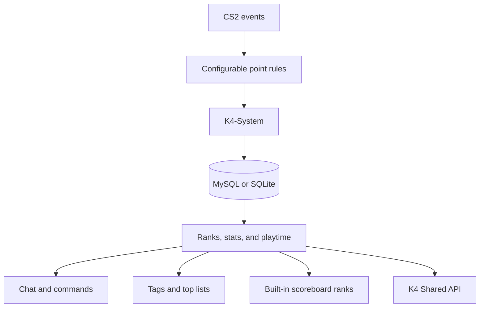

# For developers

[Back to the README](../README.md)

## How it works



Gameplay events update the enabled modules. K4-System caches active players, saves their progress to MySQL or SQLite in the background, and exposes the result through chat, commands, tags, top lists, built-in scoreboard ranks, and the shared API.

## Integrations

Enable the LevelRanks-compatible table when an older web panel needs that schema. A LevelRanks mirror failure is logged separately and cannot roll back K4's own saved data. Other plugins can use K4-SharedApi directly or execute the existing server commands:

```csharp
Server.ExecuteCommand($"css_givepoints #{player.UserId} 10");
Server.ExecuteCommand($"css_removepoints #{player.UserId} 10");
Server.ExecuteCommand($"css_resetdata #{player.UserId} rank");
```

## Building from source

```bash
dotnet build K4-System/src/K4-System.csproj -c Release
dotnet test K4-System.Tests/K4-System.Tests.csproj -c Release
```

The server package is written to `K4-System/src/bin/K4-System/`. The MySQL tests run only when `K4_TEST_MYSQL` holds a connection string; without it they are skipped. A tag `vX.Y.Z` on GitHub builds the release package and publishes it.
